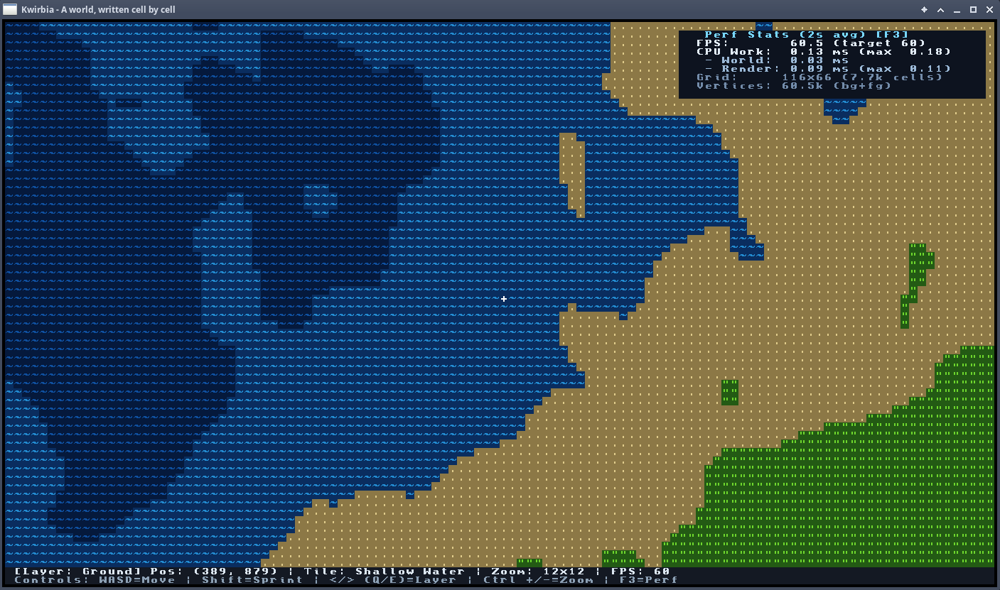

# Kwirbia

**Kwirbia**
*A world, written cell by cell.*

A 2D multi-layer ASCII game engine written in C++20. The world is drawn as a grid of text cells, and the goal is to make that grid fast enough to be the base for a real game: the GPU does the drawing, and the CPU only tracks game state.

The current build generates a procedural world with three layers (Sky, Ground, Underground) and lets you move around and look through it.



## Status

Early development. The world view, zoom, layer switching, HUD and perf overlay work. The rendering pipeline is being moved to the GPU; see [`TODO.md`](TODO.md) for the roadmap.

## Requirements

- A C++20 compiler (g++ or clang++)
- [SDL 3](https://github.com/libsdl-org/SDL) with `pkg-config` support
- An OpenGL 3.3 core capable GPU and driver

## Building

```sh
make            # optimised build (-O2)
make DEBUG=1    # debug build (-O0 -g); run `make clean` first when switching
make clean
```

This produces `./output`.

## Running

Run the binary from the repository root, because the font atlases are loaded from `media/`:

```sh
./output
```

(`make test` also builds and launches the game. There is no automated test suite yet.)

## Controls

| Key | Action |
|---|---|
| `W` `A` `S` `D` / arrow keys | Move the camera (one cell per frame) |
| `Shift` + movement | Sprint (five cells per frame) |
| `Q` / `E`, `PageUp` / `PageDown`, `<` / `>` | Change layer (Sky, Ground, Underground) |
| `Ctrl` + `+` / `Ctrl` + `-` | Zoom in / out |
| `F3` | Toggle the performance overlay |

The bottom two rows show the current layer, position, tile under the cursor, zoom, FPS and the controls.

## Project layout

- `src/main.cpp`: main loop
- `src/terrain.*`: world data, tile types and procedural generation
- `src/engine/`: window and GL context, grid, renderer, input, timing and profiler
- `src/random/`: seeded RNG and Perlin noise
- `media/`: glyph atlases (BlockyBold, 8 to 24 px)

## License

Licensed under the GNU General Public License v3.0. See [`LICENSE`](LICENSE).
